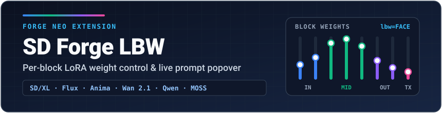

<p align="center">
  
</p>

# SD Forge LBW

Per-block LoRA weight control for **Stable Diffusion WebUI Forge (Neo)**. Tune individual U-Net or DiT layer weights directly in your prompt or through an interactive in-prompt popover.

## Key Features

- **Interactive In-Prompt Popover:** Click or move the text cursor inside any `<lora:...>` tag to open a floating editor with per-block sliders, numeric inputs, and quick actions (`All 1.0`, `All 0.0`, `Invert`).
- **Automatic Architecture Detection:** Inspects `.safetensors` (with Extra Networks metadata and active checkpoint fallbacks) to select the matching block layout.
- **Multi-Architecture Support:** Works across SD 1.5, SDXL, Flux.1, Flux.2-Klein (9B/4B), Anima (2B/2.9B/3.8B), Wan 2.1 (14B/1.3B), Qwen-Image, and MOSS-Image.
- **Legacy & Cross-Architecture Adaptation:** Automatically expands legacy 12-block and 17-block SD vectors to 26 blocks, adapts Flux 57-block vectors to Klein 32/25, and applies canonical Anima 28→40/52 block mappings.
- **Custom Presets:** Save and delete custom per-architecture presets from the popover, persisted to `lbw_presets.json`.
- **Forge Neo Native:** Scales both offline `ModelPatcher.patches` tuples and `online_mode` `OnlineLoRAPatch` wrappers, clears `current_lora_hash` only when block weights change, and isolates Hires Fix passes cleanly.

---

## Supported Architectures

| Architecture | Blocks | Layer Layout |
| :--- | :---: | :--- |
| **SD 1.5 & SDXL** | **26** | `BASE` (0), `IN00`–`IN11` (1–12), `M00` (13), `OUT00`–`OUT11` (14–25) *(auto-expands 12/17-block vectors)* |
| **Flux.1 (Dev / Schnell)** | **57** | Double `D00`–`D18` (0–18) + Single `S00`–`S37` (19–56) |
| **Flux.2-Klein 9B** | **32** | Double `D00`–`D07` (0–7) + Single `S00`–`S23` (8–31) |
| **Flux.2-Klein 4B** | **25** | Double `D00`–`D04` (0–4) + Single `S00`–`S19` (5–24) |
| **Anima 2B / 2.9B / 3.8B** | **28 / 40 / 52** | DiT stack `B00`–`B27` / `B39` / `B51` *(LLM adapter excluded; canonical 28→40 and 28→52 mapping)* |
| **Wan 2.1 14B / 1.3B** | **40 / 30** | Video DiT stack `B00`–`B39` (14B) / `B00`–`B29` (1.3B) |
| **Qwen-Image** | **60** | Transformer DiT stack `B00`–`B59` *(resamples presets for 32-block variants)* |
| **MOSS-Image** | **42** | Single-stream DiT stack `B00`–`B41` (`layers.0`–`layers.41`) |

---

## Installation

### From WebUI Forge Neo
1. Open **Extensions** → **Install from URL**.
2. Enter the repository URL:
   ```text
   https://github.com/Primer0x41/sd-forge-lbw.git
   ```
3. Click **Install**, then go to **Installed** → **Apply and restart UI**.

### Manual Installation
Clone or place this folder inside your Forge Neo `extensions` directory as `extensions/sd-forge-lbw`, then restart the WebUI.

---

## Usage

### Interactive Popover
1. Add a LoRA tag to your prompt (e.g., `<lora:my_lora:1.0>`).
2. Left-click or move the caret inside the `<lora:...>` tag.
3. Choose a preset badge, adjust the overall LoRA weight, or tune individual block sliders—the prompt tag updates in real time.

### Inline Syntax

#### 1. Built-in Presets
| Preset | Focus | Legacy Aliases |
| :--- | :--- | :--- |
| `COMPOSITION` | Pose, framing, spatial structure | `INS`, `IN`, `LAYOUT` |
| `FACE` | Identity, facial features, anatomy | `MIDD`, `MID`, `M`, `CHARACTER` |
| `STYLE` | Color grading, aesthetics, shading | `OUTS` |
| `TEXTURE` | Fine line work, grain, micro-details | `OUTD` |
| `RESET` | Full uniform activation (`1.0` on all blocks) | — |

```text
<lora:character_lora:1.0:lbw=FACE>
<lora:style_lora:0.8:lbw=STYLE>
<lora:character_lora:1.0:FACE>
```

#### 2. Comma-Separated Weight Vectors
```text
<lora:my_lora:1.0:lbw=1,1,1,0,0,0,0,0,1,1,1,0,0,0,0,0,0,0,0,0,0,0,0,0,0,0>
```

#### 3. Single-Block Isolation
Activate a single block (`1.0`) and zero out all others:
```text
<lora:my_lora:1.0:lbw=M00>
<lora:anima_lora:1.0:lbw=B14>
<lora:flux_lora:1.0:lbw=D04>
```

#### 4. Dual TE / UNet Weights & Named Options
Extra tag parameters such as a separate UNet weight or `:te=`/`:unet=` are preserved when editing in the popover:
```text
<lora:my_lora:0.8:0.5:lbw=FACE>
<lora:my_lora:1.0:te=0.6:unet=0.9:lbw=STYLE>
```

#### 5. Custom Presets
Save presets from the popover's **Save Preset** bar (stored in `extensions/sd-forge-lbw/lbw_presets.json` under your Forge data directory). Custom presets are matched case-insensitively:
```text
<lora:my_lora:1.0:lbw=MyCustomPreset>
```
